# Case Study — Employee Recruitment & Careers Portal

**Client:** Meridian & Co. (fictional) · **Agency:** ZC Smart Digital · **Budget band:** $500–$1,000
**Stack:** React · Vite · Tailwind CSS · Supabase (Postgres, Auth, Storage, Edge Functions) · Resend
**Interactive version:** open the app and go to `#/case-study`

> Portfolio demonstration. The company, people and applicant data are fictional.

---

## 1. Project objectives
- Add a hiring section to an existing corporate website where candidates can view open roles and apply.
- Present the employer brand: company introduction, benefits, culture and a transparent hiring process.
- Let HR add, edit, publish and close vacancies without a developer.
- Capture complete, validated applications with resumes, and acknowledge every candidate instantly.
- Give HR a secure dashboard to review, categorise (shortlisted / interviewed / hired / rejected), download resumes, export CSV and see statistics.
- Protect applicant data: restricted access, private file storage, spam control.

## 2. Business problem
Applications arrived as email attachments in a shared inbox. Candidates got no acknowledgement, status lived in a hand-maintained spreadsheet, hiring managers had no visibility, and CVs were forwarded and stored with no access control or retention policy.

## 3. Proposed solution
A static React application deployable under `/careers` of any existing site, backed by Supabase. A single adapter interface powers two modes from one codebase:

| | Production — working code | Public demo — simulated |
|---|---|---|
| Data | Postgres with constraints, triggers, audit log | Browser `localStorage` |
| Resumes | Private bucket, 5 MB, signed 60 s links | Browser IndexedDB |
| Admin auth | Supabase Auth + allow-list + RLS | Simulated session, published credentials |
| Validation | Edge Function, shared rules + file magic-byte check | Same shared rules in browser |
| Emails | Resend, logged | Same templates rendered as previews, not sent |

## 4. Website features
- **Careers landing page:** navigation, hero, company introduction, benefits, culture & values, open positions, 5-step recruitment process, FAQ accordion, HR contact.
- **Job listings:** 7 published vacancies (+1 draft, +1 closed), title search, department / employment type / location filters, detail pages with responsibilities and qualifications, Apply Now.
- **Application form:** full name, email, phone, position, experience, drag-and-drop resume, cover letter with counter, privacy consent, inline accessible validation, file validation, confirmation page with reference number.
- **HR dashboard:** restricted sign-in, KPI and pipeline statistics, 14-day trend, department and role breakdowns, applicant search and filters, status workflow, internal notes, authorised resume downloads, CSV export, vacancy CRUD with publish/close, email log.
- **Automation:** applicant acknowledgement, HR notification, optional status-update emails, `MC-YYYY-XXXXXX` reference numbers, email previews in demo mode.

## 5. Applicant journey
Careers page → search & filter roles → read job details → complete validated form & upload resume → receive reference number on screen and by email → hear back within 5 business days.

## 6. Recruitment workflow
`Submitted → New → Shortlisted → Interviewed → Hired`, with `Rejected` possible from any open stage. Each change is audited (who/when) and can trigger a candidate email. HR may edit status and notes only; candidate submissions are immutable.

## 7. Technologies used
React 18, React Router, Vite 8, Tailwind CSS v4, lucide icons, Supabase Postgres/Auth/Storage/Edge Functions (Deno), Resend, Vitest, Playwright, PGlite.

## 8. Testing & quality assurance
**98 automated tests, all passing** — 54 unit, 18 database/RLS against real PostgreSQL, 26 end-to-end (13 flows × desktop + mobile). Details in [QA_REPORT.md](QA_REPORT.md). One defect found during visual QA (zero-height chart bars) was fixed and re-verified.

## 9. Screenshots
| | |
|---|---|
| 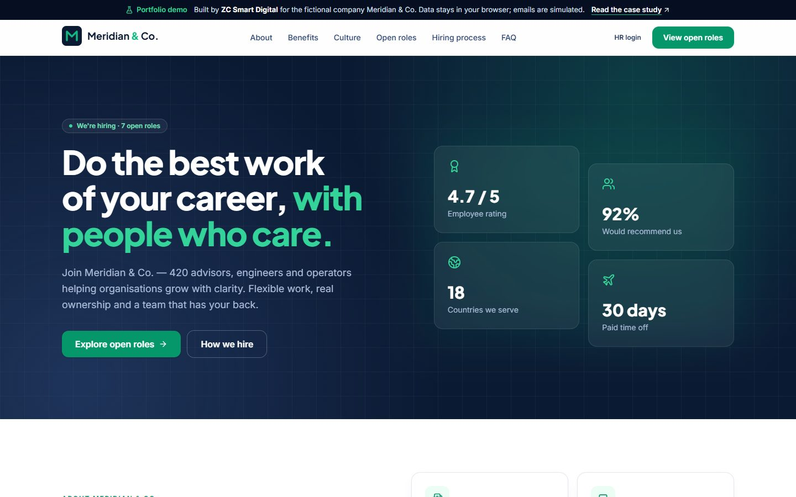 | 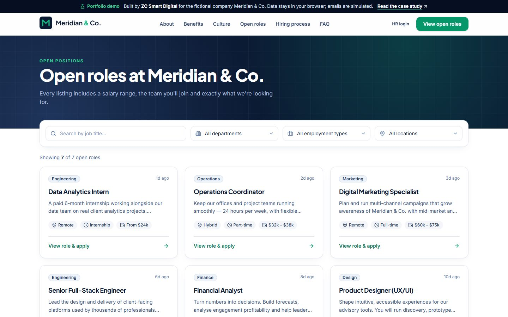 |
| Careers landing page | Job search & filters |
| 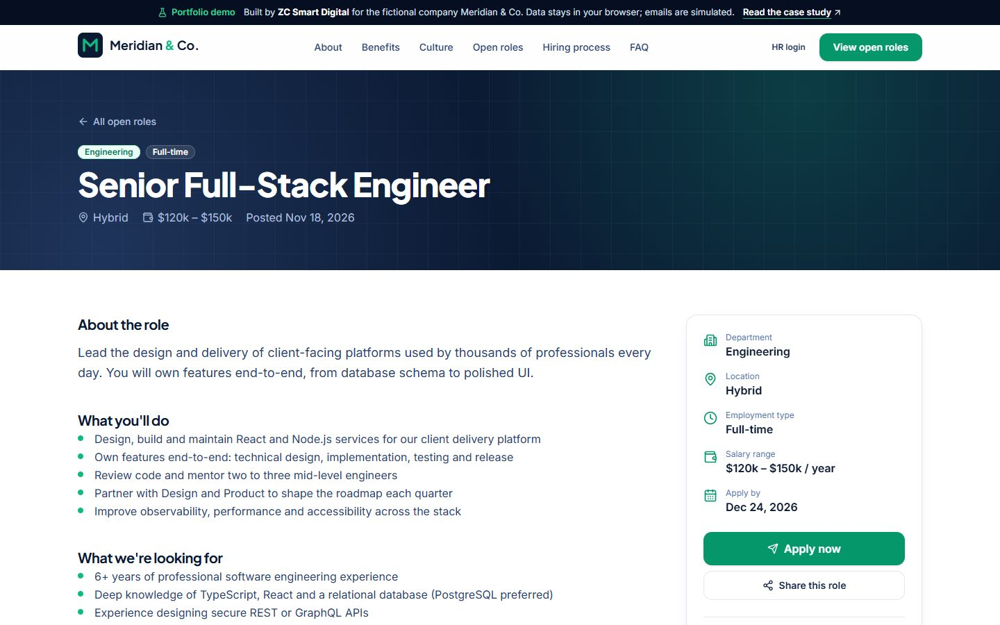 | 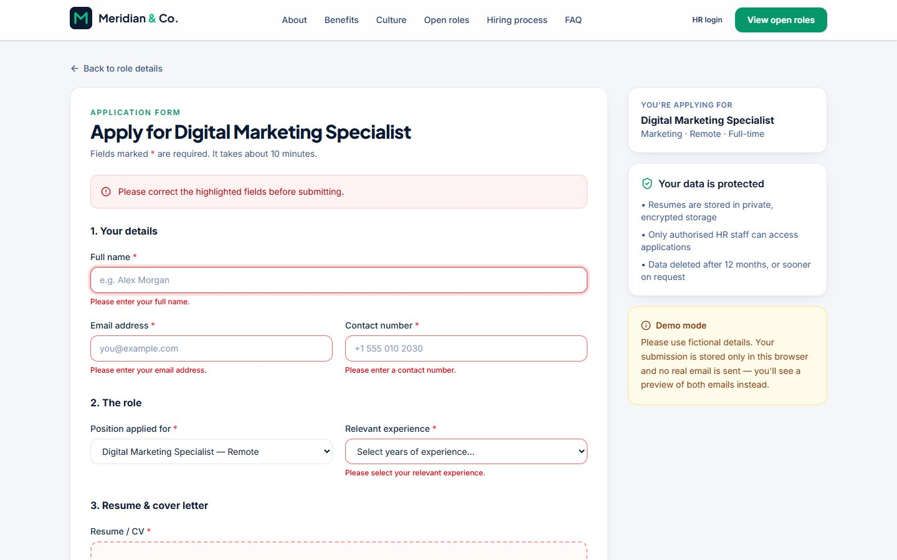 |
| Vacancy detail | Form validation |
| 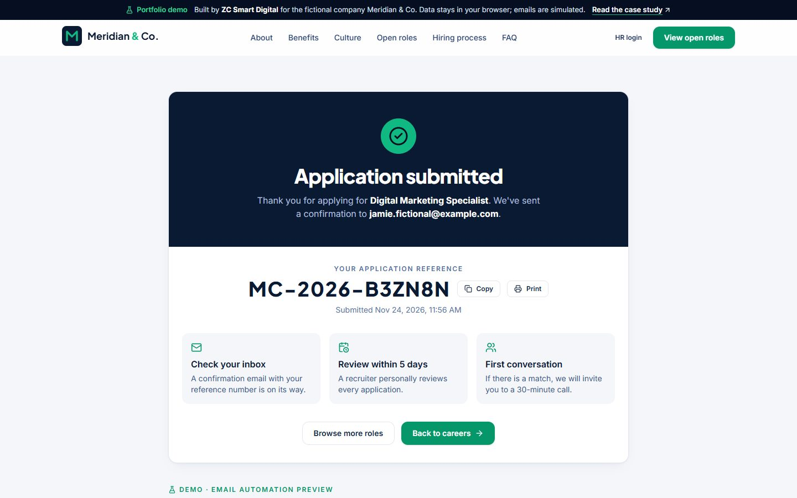 | 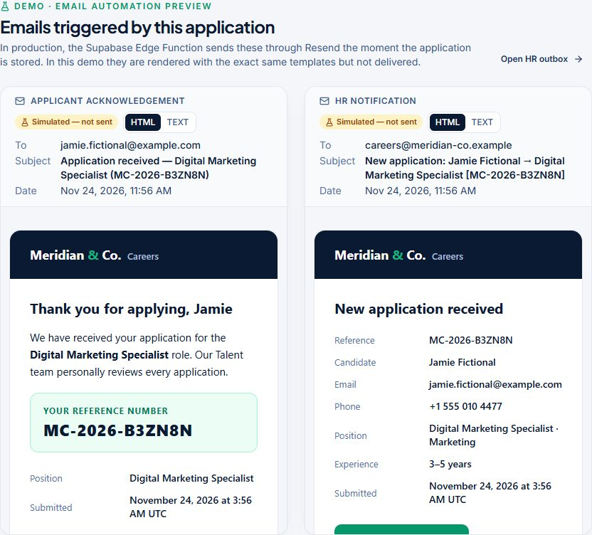 |
| Confirmation & reference | Email previews |
| 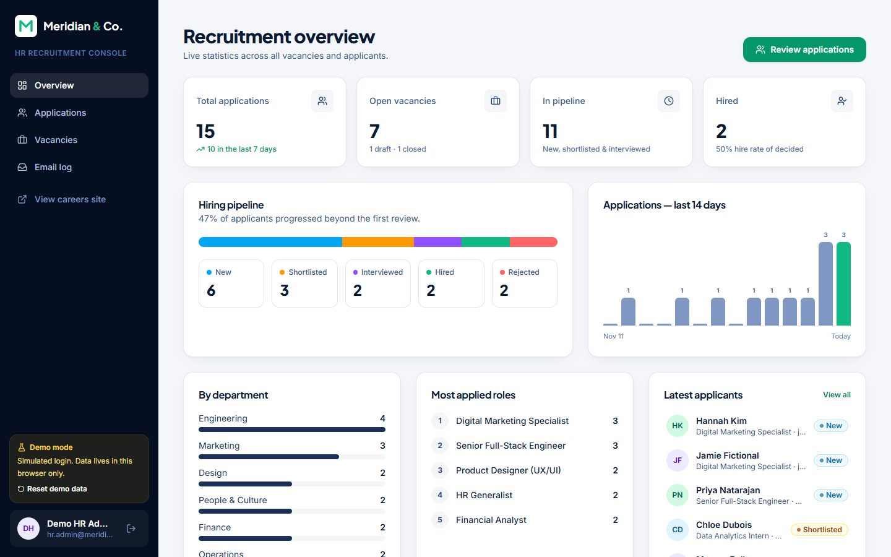 | 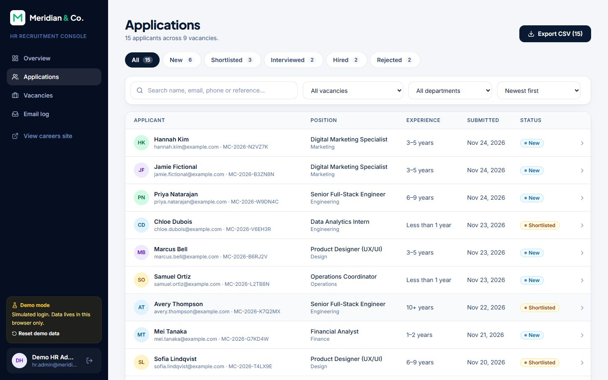 |
| HR statistics | Applicant management |
| 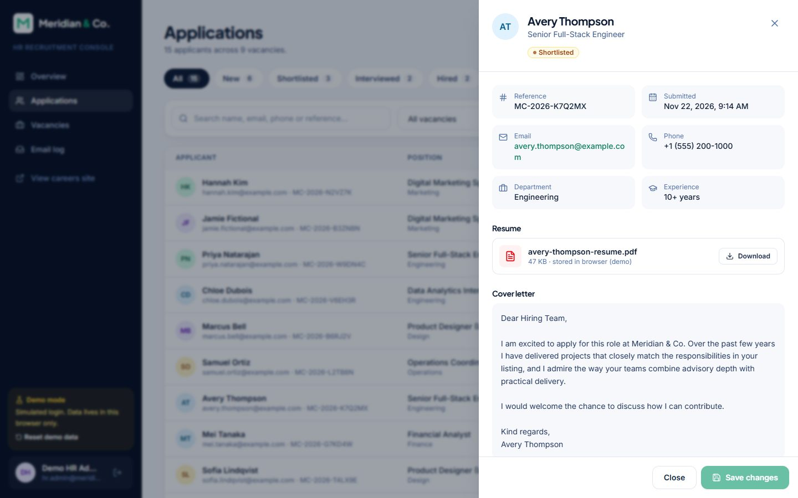 | 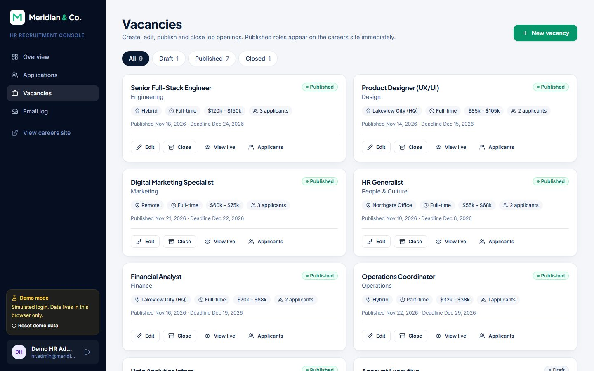 |
| Applicant detail | Vacancy management |

Mobile: 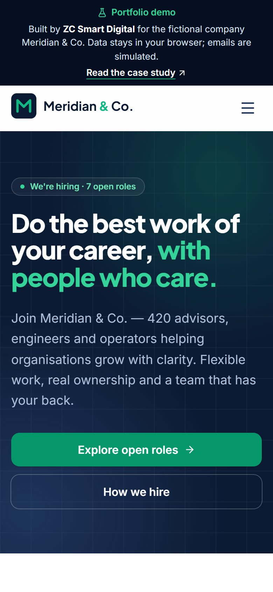 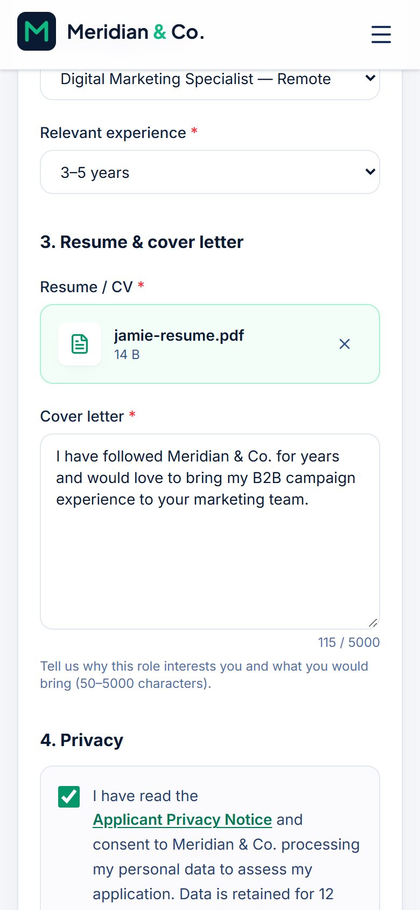 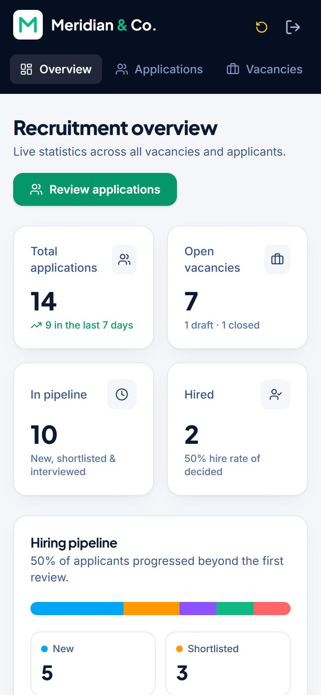

## 10. Production integration requirements
1. Supabase project — run 2 migrations, deploy 2 Edge Functions ([DEPLOYMENT.md](DEPLOYMENT.md)).
2. HR accounts created in Supabase Auth and added to `admin_users`.
3. Resend API key + verified sending domain (or swap provider).
4. Host environment variables: `VITE_APP_MODE=production`, Supabase URL + anon key. Secrets stay in Supabase.
5. Optional Cloudflare Turnstile keys.
6. Deploy to `/careers` and link from the main navigation ([INTEGRATION.md](INTEGRATION.md)).
7. Legal review of the applicant privacy notice and retention period.
